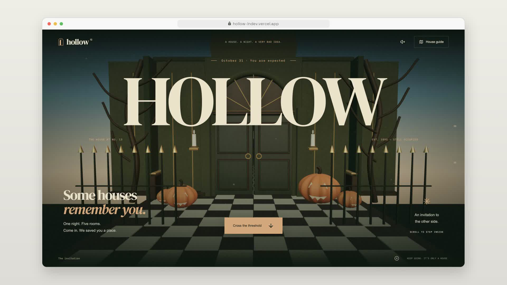
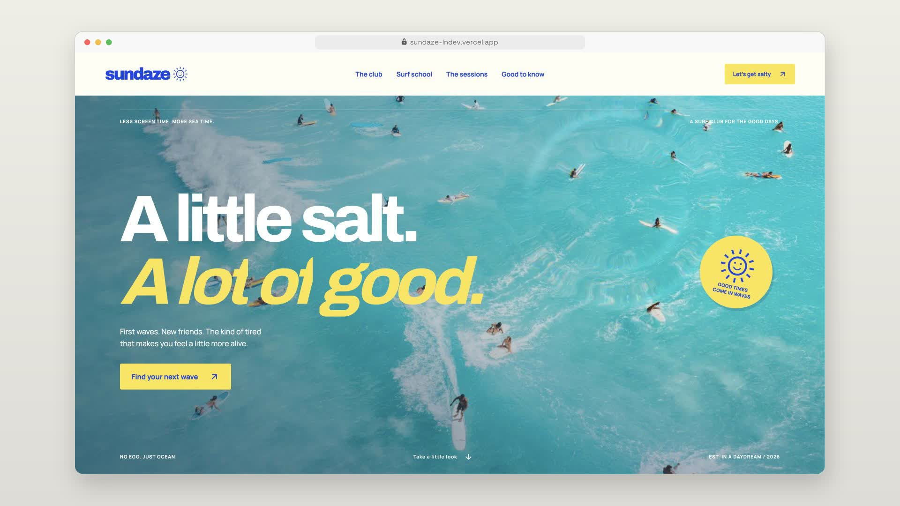

# Landing pages

Open-source landing pages with a personality of their own.
Built with Next.js, Tailwind CSS and fully customized shadcn/ui.

**[Explore the collection →](https://lp.lndev.me)**

## Projects

| Preview | Project | Concept |
| --- | --- | --- |
| [](https://hollow-lndev.vercel.app) | **[Hollow](landing-pages/hollow)** · [Live](https://hollow-lndev.vercel.app) | A haunted-house journey through a continuous 3D world |
| [](https://sundaze-lndev.vercel.app) | **[Sundaze](landing-pages/sundaze)** · [Live](https://sundaze-lndev.vercel.app) | A playful surf club with an interactive surf school |
| [](https://veillee-lndev.vercel.app) | **[Veillée](landing-pages/veillee)** · [Live](https://veillee-lndev.vercel.app) | An immersive Werewolf game night |
| [](https://tempo-lndev.vercel.app) | **[Tempo](landing-pages/tempo)** · [Live](https://tempo-lndev.vercel.app) | A sculptural chess journey with a complete grandmaster game |
| [](https://tessera-lndev.vercel.app) | **[Tessera](landing-pages/tessera)** · [Live](https://tessera-lndev.vercel.app) | Eight-room architectural 3D promenade |
| [](https://oddpress-lndev.vercel.app) | **[Oddpress](landing-pages/oddpress)** · [Live](https://oddpress-lndev.vercel.app) | Independent print club with a live ink lab |
| [](https://fallow-lndev.vercel.app) | **[Fallow](landing-pages/fallow)** · [Live](https://fallow-lndev.vercel.app) | Interactive 3D botanical story |
| [](https://offcut-lndev.vercel.app) | **[Offcut](landing-pages/offcut)** · [Live](https://offcut-lndev.vercel.app) | Furniture atelier with 3D objects |
| [](https://crux-lndev.vercel.app) | **[Crux](landing-pages/crux)** · [Live](https://crux-lndev.vercel.app) | Independent bouldering club |
| [](https://maree-lndev.vercel.app) | **[Marée](landing-pages/maree)** · [Live](https://maree-lndev.vercel.app) | Coastal bath house |
| [](https://aero-lndev.vercel.app) | **[Aéro](landing-pages/aero)** · [Live](https://aero-lndev.vercel.app) | A paper flight through a sculptural sky |
| [](https://passeline-lndev.vercel.app) | **[Passeline](landing-pages/passeline)** · [Live](https://passeline-lndev.vercel.app) | Gift delivery through an illustrated town |
| [](https://ficelle-lndev.vercel.app) | **[Ficelle](landing-pages/ficelle)** · [Live](https://ficelle-lndev.vercel.app) | Gift delivery inspired by parcels and postage |
| [](https://umbra-lndev.vercel.app) | **[Umbra](landing-pages/umbra)** · [Live](https://umbra-lndev.vercel.app) | Interactive 3D eclipse observatory |
| [](https://aparte-lndev.vercel.app) | **[Aparté](landing-pages/aparte)** · [Live](https://aparte-lndev.vercel.app) | Gift delivery with an editorial layout |
| [](https://ecrin-lndev.vercel.app) | **[Écrin](landing-pages/ecrin)** · [Live](https://ecrin-lndev.vercel.app) | Gift delivery with an animated 3D gift box |

## Run locally

Each folder in `landing-pages/` is an independent project.
Requires **Node.js 20.9+** and **pnpm**. From the repository root:

```bash
cd landing-pages/fallow # or another project
pnpm install
pnpm dev
```

For a production build, run `pnpm build`, then `pnpm start`.
See each project's README for its configuration.

## Showcase

`www/` is the collection website, built with HTML, CSS and JavaScript.
No dependencies or build step. From the repository root:

```bash
cd www
python3 -m http.server 8000
```

## Deploy

On Vercel, create a separate project for each site:

| Site | Root Directory | Framework preset |
| --- | --- | --- |
| Landing page | `landing-pages/<project>` | Next.js |
| Collection showcase | `www` | Other — no build step |

Each project’s `vercel.json` skips builds when its folder is unchanged since its previous deployment. The first deployment always builds.

## Support

Created by **[LN](https://lndev.me)**.
[Support this project and my other open-source work →](https://lndev.mychariow.shop/prd_3cu1s0)

## License

Original project code is licensed under [MIT](LICENSE).
Fonts, images and third-party components retain their own licenses; see each project's credits. Sundaze’s Canvas UI effects use MIT + Commons Clause.
